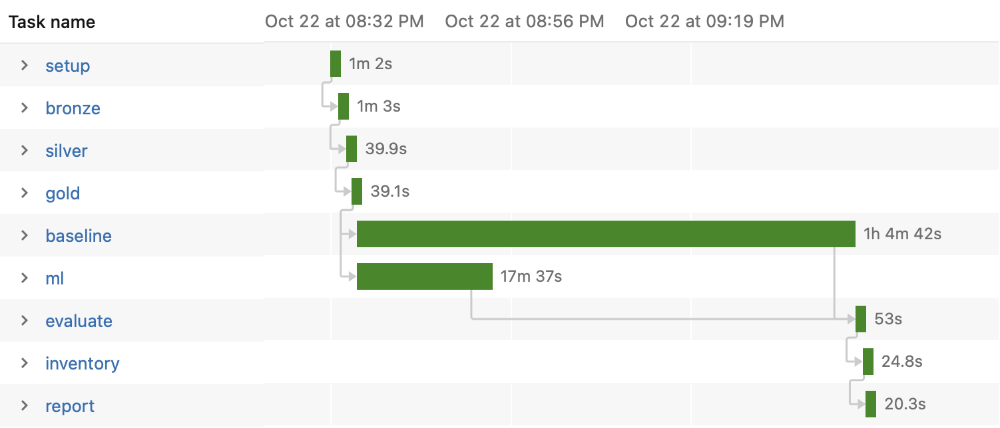

# M5 Demand Forecasting: statistical baseline vs. ML, end to end on Spark

Forecasting daily demand for Walmart's food products (M5 dataset: 10 stores in
CA, TX and WI, about 14,000 item × store series) the way a demand planning team
would: build a **statistical baseline**, test whether **machine learning** adds
value over it, measure **forecast accuracy and bias**, and translate the
difference into **service level and inventory**.

The pipeline is written in **PySpark**, packaged as a Python wheel, tested in
**GitHub Actions** and a **Docker** image, and deployed as a multi-task job to
**Databricks** (Free Edition or **Azure Databricks**) with **Databricks Asset
Bundles**.

## Questions this project answers

1. How accurate is a statistical baseline at item × store level, and where does it struggle?
2. Does a global LightGBM model add value over it (**forecast value add**, FVA)?
3. Do the models over- or under-forecast (**bias**), and for which demand patterns?
4. What is better accuracy worth: how much **safety stock** is needed to reach a 95% service level with each model?

## Results

**Scope:** all 10 stores (CA, TX, WI), 14,370 FOODS item × store series, forecast
28 days ahead and scored on a held-out test period (d_1914–d_1941). Run as a
job on Databricks. Full output: [`results/all_stores/summary.md`](results/all_stores/summary.md).

### Accuracy, bias and inventory impact

| Model | WMAPE daily | WMAPE weekly | Bias weekly | FVA vs. naive (pts) | Fill rate (95% target) | Avg. safety stock ($/day) |
|---|---|---|---|---|---|---|
| Seasonal naive (benchmark) | 78.7% | 39.1% | −9.0% | 0.0 | 91.5% | 145,502 |
| ETS | **65.6%** | 36.5% | −7.1% | +2.6 | 91.0% | 113,318 |
| Croston-SBA | 68.2% | 37.0% | −5.0% | +2.1 | **93.0%** | 119,055 |
| Statistical baseline (ETS / Croston-SBA by demand class) | 67.8% | 37.8% | **−4.8%** | +1.3 | 92.8% | 118,516 |
| LightGBM (global) | 65.7% | **35.6%** | −6.2% | **+3.4** | 92.0% | **110,899** |

WMAPE and bias are at item × store level. FVA is the weekly WMAPE improvement
over seasonal naive in percentage points.

### Weekly WMAPE by demand class (Syntetos-Boylan)

| Demand class | Naive | ETS | Croston-SBA | Statistical baseline | LightGBM |
|---|---|---|---|---|---|
| Smooth | 25.1% | 24.4% | **22.8%** | 24.4% | 23.4% |
| Erratic | 39.2% | 39.0% | **35.8%** | 39.0% | 36.6% |
| Intermittent | 47.6% | 43.4% | 45.5% | 45.5% | **42.8%** |
| Lumpy | 52.6% | 48.0% | 51.5% | 51.5% | **47.9%** |
| No sales in prior year | 100.0% | 101.6% | 147.4% | 147.4% | **92.1%** |

### Key findings

1. **LightGBM is the most accurate model and needs the least stock, but not the best service level.** It has the lowest weekly error (+3.4 points over naive), the least safety stock and the fewest excess units. Croston-SBA and the statistical baseline under-forecast less, so they reach a higher fill rate (93.0% and 92.8% vs. 92.0%). The choice depends on whether a business prioritises working capital or availability.
2. **The textbook demand-class rule picks the wrong method where it matters.** The rule assigns ETS to erratic items, where Croston-SBA was better (35.8% vs. 39.0%), and Croston-SBA to intermittent and lumpy items, where ETS was better. As a result, the rule-based baseline scored worse than either method on its own. Choosing the method per item from validation performance is the obvious next step.
3. **One store was not representative.** On store CA_1 alone, LightGBM under-forecast by 11% and Croston-SBA was best on newly selling items; across all 10 stores, LightGBM's bias fell to 6% and Croston-SBA was the worst on those items (147% error). Conclusions from a single store or segment need checking at full scale.
4. **Every model under-forecasts and misses the 95% target.** M5 cannot separate zero sales from stock-outs, so training data understates true demand.

### Run on Databricks

The pipeline runs as a 9-task Databricks job deployed with Databricks Asset
Bundles, with the statistical baseline and LightGBM in parallel.



*Timeline of the 10-store run: the statistical baseline (1 h 5 min) and LightGBM (18 min) run in parallel; the baseline sets the total run time.*

| Run | Total time | baseline | ml |
|---|---|---|---|
| 1 store (CA_1, 1,437 series) | 13 min | 8.6 min | 5.5 min |
| 10 stores (14,370 series) | about 70 min | 64.7 min | 17.6 min |

The statistical baseline is the critical path: AutoETS selects a model form for
every series. Spreading it over more parallel groups, or reusing the selected ETS
form between runs, would shorten the job most.

### Next steps

- Choose the forecasting method per item from validation-fold performance ("best fit"), instead of the fixed demand-class rule.
- Correct LightGBM's bias using the validation fold, then re-check fill rate.
- Speed up the baseline task (more parallel groups) and give the bronze stage an explicit schema instead of `inferSchema`, which reads each CSV twice.

*A one-store run (CA_1) is kept in [`results/ca1/summary.md`](results/ca1/summary.md) as a quick local check. LightGBM results can differ slightly between machines because of floating-point differences in tree building; statistical model results are identical.*

## Approach

```
Kaggle CSVs ─► bronze ─► silver ─► gold ─┬─► statistical baseline ─┐
               (raw)    (long,    (lag    │   (per series, Spark    ├─► evaluate ─► inventory ─► report
                         joined,  features)│    applyInPandas)       │   (WMAPE,     (safety stock,
                         scoped)           └─► LightGBM (global) ────┘    bias, FVA)  fill rate)
```

| Stage | What it does |
|---|---|
| `bronze` | Loads the three raw CSVs unchanged (Delta tables on Databricks, Parquet locally). |
| `silver` | Unpivots the wide `d_1…d_1941` sales into one row per item × store × day, joins calendar (events, state-specific SNAP days) and weekly prices, keeps the configured scope (default: FOODS) and drops days before an item's launch in a store, which are not real zero demand. |
| `gold` | Leak-free features: sales lags of 28–56 days, rolling means/std ending 28 days back, price relative to the item's usual price, price change, days since launch, calendar. Because every feature looks back at least one full horizon, one model forecasts all 28 days directly. |
| `baseline` | Per series, with statsforecast inside Spark `applyInPandas` (one task per store × department): seasonal naive, AutoETS and Croston-SBA. Each series is classified with the **Syntetos-Boylan** scheme (ADI / CV²) into smooth, erratic, intermittent or lumpy demand; the **statistical baseline** uses ETS for smooth/erratic and Croston-SBA for intermittent/lumpy series. |
| `ml` | One global LightGBM model across all series, Tweedie loss (many zeros, long tail), trained on the last 730 days before each cutoff. |
| `evaluate` | WMAPE, bias and FVA against seasonal naive, at daily and weekly item × store level, split by store, department and demand class. |
| `inventory` | Sizes safety stock from each model's validation-fold error (`z × RMSE × √lead time`) and replays real demand on the test fold: fill rate, lost units, excess units and safety-stock value. |

**Backtesting.** Two rolling origins with a 28-day horizon: the first fold
(days 1886–1913) is used for validation and for sizing safety stock; the second
(days 1914–1941) is the held-out test.

## Run it

**Locally** (Python 3.10+ and Java 17+):

```bash
pip install -e ".[dev]"
pytest -q                                                    # unit + end-to-end tests on synthetic data
python -m m5fc.synthetic --out data/synthetic/raw            # quick demo without Kaggle data
m5fc --config conf/synthetic.yml --stage all
# real data: put calendar.csv, sell_prices.csv, sales_train_evaluation.csv in data/raw/
m5fc --config conf/local_ca1.yml --stage all                 # one store, ~10-15 min
m5fc --config conf/local.yml --stage all                     # all 10 stores
```

**VS Code**: open the folder, select the `.venv` interpreter, then use the Run and Debug panel (ready-made configurations in `.vscode/launch.json`) and the Testing panel.

**Docker**:

```bash
docker build -t m5fc .
docker run --rm m5fc                                         # test suite
docker run --rm -v "$PWD/data:/app/data" -v "$PWD/results:/app/results" m5fc \
  m5fc --config conf/local.yml --stage all
```

**Databricks** (see [docs/setup.md](docs/setup.md)):

```bash
databricks bundle deploy -t dev
databricks bundle run m5_forecasting -t dev
```

## CI/CD

- **CI** (`.github/workflows/ci.yml`), on every push and pull request: ruff lint and format check, pytest (unit tests plus an end-to-end run of every stage on synthetic M5-shaped data), Docker build with the tests run inside the image, and `databricks bundle validate`.
- **CD** (`.github/workflows/deploy.yml`): after CI passes on `main`, builds the wheel and deploys the job with `databricks bundle deploy`; a manual run can target Free Edition (`dev`) or Azure Databricks (`azure`) and start the job.

## Repository layout

```
src/m5fc/        pipeline code (transform, baseline, ml_model, evaluate, inventory, report, pipeline CLI)
conf/            run configs: local.yml, local_ca1.yml, synthetic.yml, databricks_run.yml
.vscode/         VS Code settings, run/debug configurations
tests/           pytest suite, runs on generated synthetic data
resources/       Databricks job definition (one task per stage)
databricks.yml   Databricks Asset Bundle
Dockerfile       reproducible environment (Python, Java, Spark)
```

## Limitations

- The inventory step is a simplified daily order-up-to model for comparing forecasts on equal terms, not a full replenishment simulation (no lead-time demand distribution, pack sizes or review periods).
- Prices in the horizon are treated as known (planned prices), which is realistic for a retailer's own pricing but would not hold for competitor prices.
- The M5 data stops in 2016 and has no promotions, stock-outs or supply constraints recorded; zero sales can hide stock-outs, which biases all models downward on those days.

## Data

[M5 Forecasting – Accuracy](https://www.kaggle.com/competitions/m5-forecasting-accuracy) (Walmart via Kaggle). The data is not included in this repository; download it from Kaggle after accepting the competition rules.
